<div align="center">

<!-- Hero Banner: Custom Animated 3D Floating Shapes (Cubes, Stars, +, -, Circles) -->


<br/>

<!-- Typing SVG in Electric Cyan -->
<a href="https://github.com/Anshika646">
  
</a>

<br/>


</div>

## 💜 About Me

```python
class Anshika:
    """
    Explorer passionate about Data Science, Machine Learning, and Modern Web Development.
    """
    def __init__(self):
        self.name       = "Anshika"
        self.focus      = ["Data Analysis", "Machine Learning", "Web Development"]
        self.languages  = ["Python", "SQL", "JavaScript", "HTML/CSS"]
        self.tools      = ["Pandas", "NumPy", "MySQL", "MongoDB", "Git"]
        self.philosophy = "Turning data into insights & designs into experiences ✨"
```

A developer and data enthusiast focused on **Python, Machine Learning, SQL, and Modern Web Development**. I love analyzing data, designing clean user interfaces, and building intuitive applications.

<br/>

<div align="center">

</div>

## 🛠️ Technical Skills

<div align="center">

<p align="center">
  <sub><b>LANGUAGES &amp; DATA SCIENCE</b></sub><br/><br/>
  <a href="https://skillicons.dev">
    
  </a>
</p>

<p align="center">
  <sub><b>FRONTEND &amp; WEB DEVELOPMENT</b></sub><br/><br/>
  <a href="https://skillicons.dev">
    
  </a>
</p>

<p align="center">
  <sub><b>DATABASES &amp; DEVELOPER TOOLS</b></sub><br/><br/>
  <a href="https://skillicons.dev">
    
  </a>
</p>

</div>

<br/>

<div align="center">

</div>

## 🐍 GitHub Contributions

<div align="center">

<!-- Dark Contribution Grid Snake Animation -->


</div>

<br/>

<div align="center">

</div>

## 📊 GitHub Analytics

<div align="center">

<table align="center" width="860" style="border-collapse: collapse; border: none; margin: 10px auto 0 auto;">
  <tr align="center">
    <td align="center" width="50%" style="border: none; padding: 6px;">
      <a href="https://github.com/Anshika646">
        
      </a>
    </td>
    <td align="center" width="50%" style="border: none; padding: 6px;">
      <a href="https://github.com/Anshika646">
        
      </a>
    </td>
  </tr>
</table>

</div>

<br/>

<div align="center">

</div>

## 📬 Connect

<div align="center">

<p align="center">
  Always excited to connect, learn, and collaborate on interesting projects!
</p>

<p align="center">
  <a href="https://github.com/Anshika646">
    
  </a>
  &nbsp;
  <a href="https://linkedin.com/in/">
    
  </a>
</p>

<br/>

<sub>Made with 💜 by Anshika</sub>

</div>
