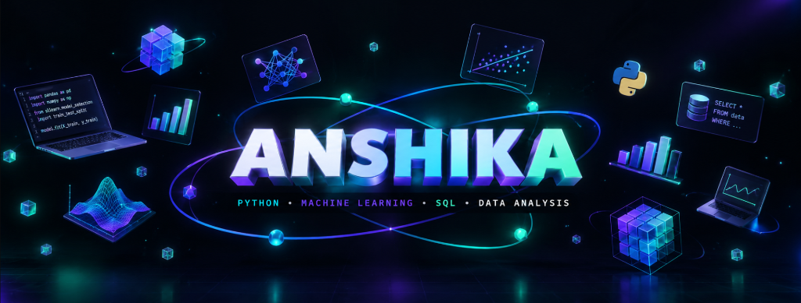
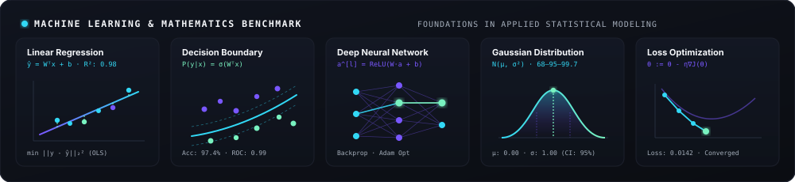

<div align="center">

<!-- 3D Cinematic Hero Banner -->


<br/>

<!-- Dynamic Typing SVG in Electric Cyan -->
<a href="https://github.com/Anshika646">
  
</a>

<br/>


</div>

## 🌌 About Me

<table width="100%" style="border-collapse: collapse; border: none; margin: 8px 0;">
  <tr>
    <td style="border: 1px solid #1C202C; background-color: #0E121A; border-radius: 12px; padding: 22px;">
      <span style="color: #FF5F56; font-size: 14px;">●</span> <span style="color: #FFBD2E; font-size: 14px;">●</span> <span style="color: #27C93F; font-size: 14px;">●</span> &nbsp; <code style="color: #A4ADBA; font-size: 13px;">anshika@intelligence-lab:~</code>
      <br/><br/>

```python
class Anshika:
    """
    Data Scientist & Computational Explorer turning multi-dimensional 
    datasets into predictive intelligence and elegant software experiences.
    """
    def __init__(self):
        self.name       = "Anshika"
        self.focus      = ["Machine Learning", "Data Analysis", "Frontend Engineering"]
        self.languages  = ["Python", "SQL", "JavaScript", "HTML/CSS"]
        self.libraries  = ["Pandas", "NumPy", "Scikit-Learn", "Matplotlib", "Seaborn"]
        self.databases  = ["PostgreSQL", "MySQL", "MongoDB"]
        self.philosophy = "From raw observations to empirical mathematical truths ✨"

    def status(self) -> str:
        return "Actively analyzing distributions, training models, and engineering UIs."
```

<p style="color: #F5F7FA; font-size: 14.5px; line-height: 1.6; margin-top: 14px; margin-bottom: 4px;">
  An inquisitive data practitioner focused on <b>applied machine learning, data storytelling, and scalable data transformations</b>. I specialize in extracting patterns from raw data using <b>Python &amp; SQL</b>, evaluating model architectures, and building intuitive, responsive digital experiences.
</p>

</td>
</tr>
</table>

<br/>

<div align="center">

</div>

## 🛠️ Technical Competencies

<div align="center">

<table width="100%" style="border-collapse: collapse; border: none; margin: 12px 0;">
  <tr>
    <td width="50%" valign="top" style="border: 1px solid #1C202C; background-color: #0E121A; border-radius: 10px; padding: 18px; margin: 6px;">
      <h4 style="margin: 0 0 10px 0; color: #32D8F5;">🐍 Data Science &amp; Machine Learning</h4>
      <p style="color: #A4ADBA; font-size: 13.5px; line-height: 1.5; margin: 0;">
        <code>Python</code> <code>Pandas</code> <code>NumPy</code> <code>Scikit-Learn</code> <code>TensorFlow</code> <code>PyTorch</code> <code>Matplotlib</code> <code>Seaborn</code>
      </p>
    </td>
    <td width="50%" valign="top" style="border: 1px solid #1C202C; background-color: #0E121A; border-radius: 10px; padding: 18px; margin: 6px;">
      <h4 style="margin: 0 0 10px 0; color: #7957FF;">🗄️ Databases &amp; Data Engineering</h4>
      <p style="color: #A4ADBA; font-size: 13.5px; line-height: 1.5; margin: 0;">
        <code>SQL</code> <code>PostgreSQL</code> <code>MySQL</code> <code>MongoDB</code> <code>Schema Design</code> <code>ETL Pipelines</code> <code>Relational Modeling</code>
      </p>
    </td>
  </tr>
  <tr>
    <td width="50%" valign="top" style="border: 1px solid #1C202C; background-color: #0E121A; border-radius: 10px; padding: 18px; margin: 6px;">
      <h4 style="margin: 0 0 10px 0; color: #79F2C0;">🌐 Web Development &amp; Frontend</h4>
      <p style="color: #A4ADBA; font-size: 13.5px; line-height: 1.5; margin: 0;">
        <code>JavaScript</code> <code>TypeScript</code> <code>React</code> <code>HTML5</code> <code>CSS3</code> <code>Tailwind CSS</code> <code>Responsive UI/UX</code>
      </p>
    </td>
    <td width="50%" valign="top" style="border: 1px solid #1C202C; background-color: #0E121A; border-radius: 10px; padding: 18px; margin: 6px;">
      <h4 style="margin: 0 0 10px 0; color: #F5F7FA;">⚙️ Developer Tools &amp; Environment</h4>
      <p style="color: #A4ADBA; font-size: 13.5px; line-height: 1.5; margin: 0;">
        <code>Git</code> <code>GitHub</code> <code>VS Code</code> <code>Jupyter Notebooks</code> <code>Linux / Bash</code> <code>Postman</code>
      </p>
    </td>
  </tr>
</table>

<br/>

<!-- Interactive Dark-Themed Skill Icons -->
<a href="https://skillicons.dev">
  
</a>

</div>

<br/>

<div align="center">

</div>

## 📐 Machine Learning & Statistical Foundations

<div align="center">

</div>

<br/>

- **Optimization Dynamics:** Objective loss minimization $\min_\theta \mathcal{L}(\theta)$ using gradient descent, backpropagation, and momentum-based optimizers.
- **Decision Manifolds:** High-dimensional separation surfaces via kernel transformations, non-linear activation functions ($\sigma(z), \mathrm{ReLU}$), and ensemble voting.
- **Statistical Inference:** Probabilistic distributions $\mathcal{N}(\mu, \sigma^2)$, hypothesis testing ($p$-values, confidence intervals), and empirical feature importance.
- **Model Evaluation:** Generalization assessment with cross-validation, $R^2$, RMSE, ROC-AUC curves, and confusion matrix calibration.

<br/>

<div align="center">

</div>

## 🐍 GitHub Contributions

<div align="center">

<!-- Dark Contribution Grid Snake Animation -->


</div>

<br/>

<div align="center">

</div>

## 📊 Analytics & Activity

<div align="center">

<table align="center" width="860" style="border-collapse: collapse; border: none; margin: 10px auto 0 auto;">
  <tr align="center">
    <td align="center" width="50%" style="border: none; padding: 6px;">
      <a href="https://github.com/Anshika646">
        
      </a>
    </td>
    <td align="center" width="50%" style="border: none; padding: 6px;">
      <a href="https://github.com/Anshika646">
        
      </a>
    </td>
  </tr>
</table>

</div>

<br/>

<div align="center">

</div>

## 📬 Connect & Collaborate

<div align="center">

<p align="center" style="color: #A4ADBA; font-size: 14.5px;">
  Open to exploring opportunities in <b>Data Science, Machine Learning research, and Open Source software</b>.
</p>

<p align="center">
  <a href="https://github.com/Anshika646">
    
  </a>
  &nbsp;
  <a href="mailto:anshika@example.com">
    
  </a>
  &nbsp;
  <a href="https://linkedin.com/in/">
    
  </a>
</p>

<br/>

<sub>Crafted with empirical precision &amp; algorithmic curiosity • Anshika</sub>

</div>
